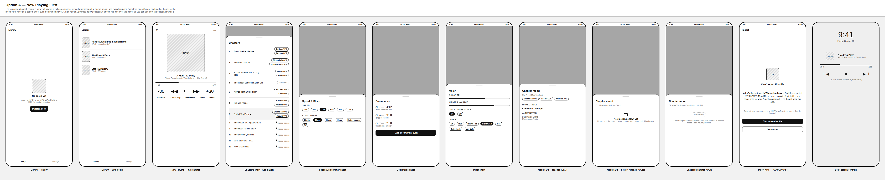
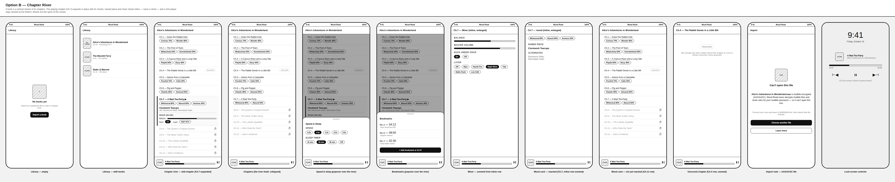
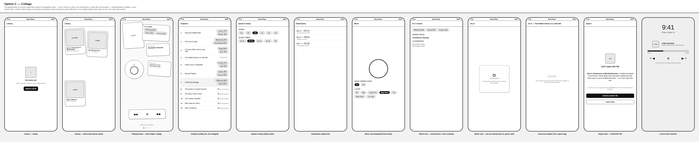

# Layout options — comparison

Three wireframe boards answer the same question — what is the main screen while a book plays? — for
the same fake book, **Alice's Adventures in Wonderland** (12 chapters, invented moods and invented
named pieces, not real scoring). Grayscale only, system font, plain boxes: this pass is about structure,
not the design system. Open any board straight from disk, no server needed:

- [`option-a.html`](./option-a.html) / 
- [`option-b.html`](./option-b.html) / 
- [`option-c.html`](./option-c.html) / 

Each board is a single horizontal row of 12 phone-sized frames (390×844), one per screen/state, with a
caption under each frame. A single row (not a wrapped grid) was the call here: it keeps every frame's
pixel position deterministic — easy to reason about and to re-screenshot exactly — at the cost of a wide
image, which is fine for a side-by-side comparison viewed by scrolling or in an image viewer.

## Option A — Now Playing first

The familiar audiobook shape: a library of covers, a full-screen Now Playing screen with a large
transport at thumb height, and everything else — chapters, speed/sleep, bookmarks, the mixer, the mood
card — rises as a bottom sheet over the dimmed player. It is the safest, most Audible-like option: a
listener who has used any audiobook app already knows where everything is. The cost is that moods and
the named piece, Mood Read's whole premise, are one tap away behind a sheet rather than visible on the
screen a listener spends most of their time looking at.

## Option B — Chapter river

A book is a vertical stream of its chapters. The chapter currently playing expands in place, right in
the stream, showing its moods, its named piece and the mixer inline — never a sheet — while a mini
player stays docked at the bottom for transport and scrubbing. Moods are the spine of the screen, not an
afterthought. This is the least familiar of the three to an Audible listener (there is no classic
full-screen Now Playing hero screen) but it is still a plain scrollable list underneath, so it stays
buildable with ordinary React Native list components, just with more custom expand/collapse and
docked-player plumbing than option A.

## Option C — Collage

The playing book as a loose, asymmetric board of overlapping cards — cover, the chapter's moods as
chips, the named piece, a mixer dial, the transport — swiped between chapters. It leans hardest into the
owner's "gen z chaotic" instinct and gives moods and the named piece the most real estate of the three.
It is also the furthest from what an Audible listener expects, the hardest to keep reliably one-handed
(overlapping cards don't all sit in the thumb zone), and by far the most expensive to build and maintain
in React Native: absolute-positioned, rotated, overlapping layout that has to stay legible across device
sizes, plus custom swipe-between-chapters gesture handling. The secondary screens (chapters, speed/sleep,
bookmarks) fall back to plain utility lists in this option, which the board itself shows — the collage
budget is deliberately spent on the one screen that matters.

## Scoring

| Criterion | A — Now Playing first | B — Chapter river | C — Collage |
|---|---|---|---|
| One-handed reach | High — large transport sits at thumb height; sheets rise from the bottom within reach | Medium — mini player is always in reach, but the river itself is a normal scroll, and inline-expanded controls can land anywhere on screen | Medium-low — swipe-to-change-chapter is thumb-friendly, but tapping a specific overlapping card accurately is not guaranteed to land in the thumb zone |
| Glanceability while listening | Low-medium — moods, piece and mixer are all behind a sheet; the resting screen shows only cover, title and transport | High — moods, piece and mixer are inline in the stream, visible while scrolling, no extra tap | Medium-high — everything is visible on one board at once, but the asymmetric overlap takes a moment longer to scan than a flat list |
| How present moods and pieces are | Low — one tap away, behind the "Mood" sheet | High — the stated spine of the screen | Highest — first-class cards on the primary screen, the most visual weight of the three |
| Distance from what an Audible listener expects | Lowest — library of covers, full-screen player, bottom sheets is the standard shape | Medium — no classic Now Playing hero screen, but still a familiar scrolling list underneath | Highest — no option here looks like a conventional audiobook app |
| Build cost in React Native | Low — covers grid, full-screen player and bottom sheets are well-trodden RN patterns (e.g. a standard bottom-sheet library) | Medium — virtualized list with one inline-expanded item, animated expand/collapse, and a persistently docked mini player coordinated with scroll position | High — absolute-positioned, rotated, overlapping cards that must stay legible across device sizes, plus custom swipe-between-chapters gesture handling |

## Recommendation

**Option B, chapter river.** Moods and the named piece are Mood Read's entire premise — scoring each
chapter by the emotions it evokes is the one thing that makes this app different from Audible. Option A
buries that premise behind a tap, which undersells it on the screen a listener looks at most. Option C
gives moods the most visual weight of the three, but at the highest build cost and the largest jump away
from a shape listeners already know, which is a lot of risk to take on for the first shippable layout.
Option B keeps moods and pieces glanceable and inline, without the heaviest custom gesture and layout
work option C needs, and it still reads as a plain scrollable list under the hood — the cheapest path to
"moods are the spine of the screen" that a React Native team can actually ship first. If the owner wants
more of C's energy later, option B's inline chapter cards are a reasonable place to bring in collage-style
flourishes once the design system (palette, type, motion) lands.
